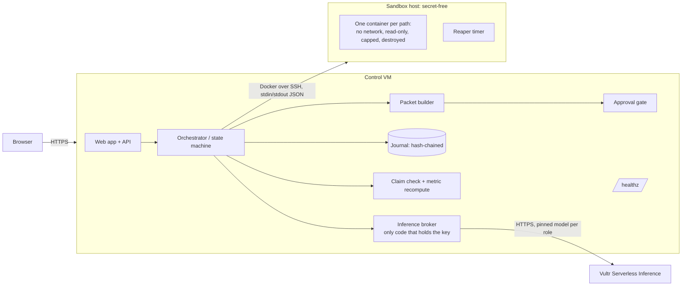

# Architecture

All data in this project is synthetic. This page describes the design; anything marked `[CONFIRM AT SUBMISSION]` is not yet verified against a deployment.

## Trust domains
| Domain | Holds | Never holds |
|---|---|---|
| Control plane | inference key, journal, sealed answer key, decision rule | executes no model-written code |
| Sandbox container | the code under test and the visible event rows | any secret, any answer key, any network |
| Browser | the packet and the scan result | nothing system-specific |

## Components
| Component | Directory | Notes |
|---|---|---|
| Dataset generator and MRI | `dataset/`, `mri/` | seeded; the MRI is deterministic and read-only |
| Scoring | `scan/` | computes the overall index from the answer sum only |
| Broker | `broker/` | one client class, one base URL constant, pinned model per role, fails closed on a model mismatch, token budgets, key redaction |
| Council port | `council/` | role prompts, strict JSON parsing, seeded neutral-label shuffle |
| Control plane | `control/` | orchestrator, state machine, journal, claim checker, metric recompute, packet builder, approval gate, API |
| Sandbox | `sandbox/` | image, flag builder, runner, reaper |
| Verifier | `tools/verify_packet.py` | independent, stdlib only |
| Web app | `web/` | one flow, five stages |

## Run state machine
`CREATED, DATASET_LOADED, MRI_DONE, SCAN_DONE, COUNCIL_EVIDENCE, COUNCIL_PATHS, COUNCIL_CRITIC, [COUNCIL_REVISION], COUNCIL_DECISION, DECISION_RULE_FROZEN, EXEC_PATH (per path), CLAIM_CHECKED, [EXEC_CORRECTION], PACKET_BUILT, AWAITING_APPROVAL, APPROVED_VIEWED or EXPIRED`. Any error moves to `FAILED_CLOSED`, which still produces a packet marked INCOMPLETE. No state is skipped; nothing executes before the decision rule is frozen.

## Deployment shapes
- T1: control VM plus a separate sandbox VM. The sandbox VM accepts SSH only from the control VM.
- T0: both on one VM. The claim ceiling is lower and stated.
`[CONFIRM AT SUBMISSION: which shape is deployed]`
